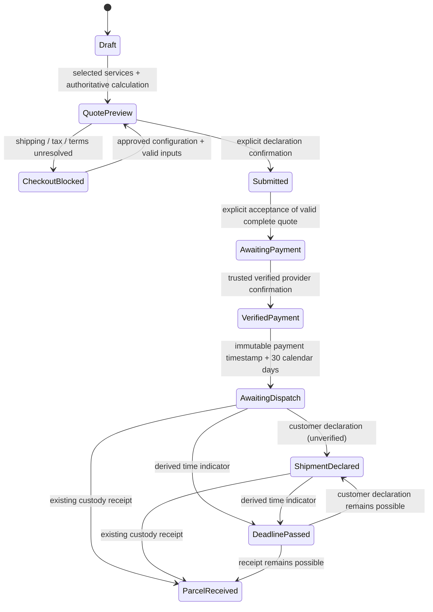

# SELBY V0.6a — Paid Order Foundation

Implemented against the confirmed November 2026 commercial decisions. The earlier V0.6a specification was not present in this conversation or found in the repository; a clarification was requested. This delivery documents the implemented scope explicitly rather than claiming verification against that missing document.

## Architecture audit and conflicts resolved

| Existing architecture | V0.6a change |
| --- | --- |
| `Submission` / `SubmissionEntry` already represent customer orders and declared copies | Reused; no parallel order or grading system |
| `processing_tier` already stores a stable per-entry service key, with quantity | Retained as the service identifier. Each quote records entry/copy keys, selected service, quantity, unit price and tax treatment |
| Legacy catalogs price base + tier adjustment + upgrades | Catalog schema 2 supports absolute service prices and explicit per-service tax; schema 1 remains readable |
| First-card/library registration assumes `standard`; mixed configurations block the V1 UI | New-schema drafts can have an unselected service until explicitly configured. Mixed orders can add cards, select services per entry, generate quotes and confirm |
| Quotes and quote acceptance are immutable; acceptance is separate from order confirmation | Preserved. New acceptances require complete shipping/tax/terms information and create an unpaid obligation |
| Shipping already has versioned configuration, addresses, declared value and parcel limits | Extended with exclusive tax, zones, card-count limits and explicit incremental additional-card rates |
| Return parcel measurements were described as an after-encapsulation task | Checkout now explains that a reliable return rate must be determined before acceptance. Unknown size-dependent pricing remains blocked; no packaging assumptions are invented |
| Inspection commercial evidence intentionally fails closed | Unchanged. The new ledger does not replace or enable the grading provider |
| No verified-payment or dispatch-deadline domain | Added immutable obligations, trusted confirmations, dispatch expectations, customer declarations and audit events on existing order IDs |
| Additional PCs already have custody identity and discrepancy records | Supplementary quotes reuse `SubmissionQuote`, scoped to an existing PC and existing order; no PC, ORD, SLB-C or grading session is allocated |

Public services remain advertised as pending launch. No actual service names, prices, turnaround promises, VAT rates, carrier terms or insurance limits were introduced or published. Numeric catalogs and provider confirmations in tests are explicitly synthetic.

## Commercial state machine

Order declaration state remains the existing draft/submitted state. Commercial, dispatch and custody state are independent. Dispatch indicators may coexist; a late declaration does not erase the passed-deadline indicator.

**V0.6a cannot initiate the payment transition through HTTP or customer settings.** No provider verifier is configured, no charging endpoint exists, and all payment actions remain disabled. Acceptance alone never writes `VerifiedPayment` or a deadline. The provider seam is exercised only with synthetic verifiers in isolated tests.

Deadline passage does not cancel an order, forfeit money, trigger a refund, create missing-card discrepancies or change custody/inspection state. Staff can append an explicit manual-review decision with a reason. A physical receipt can be reported alongside an unpaid state; receipt is never hidden or treated as payment evidence.

Additional cards follow a separate commercial branch on the same order:

```mermaid
flowchart LR
    PC[Existing received PC + documented unexpected-card discrepancy] --> Q[Explicit service + supplementary quote]
    Q --> S[Re-evaluate aggregate declared value, card count and return shipping]
    S --> A[Customer acceptance]
    A --> O[Separate unpaid obligation]
    O --> P[Separate trusted payment verification]
    P --> B[Explicit PC entitlement assignment]
    B --> C[Commercial checks complete]
    C --> G[Existing custody / reconciliation / inspection gates]
```

Assignment may be recorded before payment, but does not grant eligibility. The domain requires payment for the original shipping baseline and for the specific supplementary obligation. Another accepted supplement invalidates competing unaccepted supplements so aggregate shipping/insurance inputs must be recalculated. A change of return shipping service requires review; it is not silently treated as a same-service incremental fee.

## Immutable quote and money behavior

All authoritative calculations use integer EUR minor units with exact Decimal half-up rounding. Tax is rounded per entry line; shipping is a separate line. Inclusive prices extract tax, exclusive prices add tax, and exempt prices require a zero rate. The final payable amount is the sum of gross grading line totals and gross return shipping, with adjustments currently explicitly zero. The displayed total tax is informational and is not added again.

Snapshots preserve:

- Declared entry metadata, stable entry/copy keys, service key/name/description, quantity, unit price and optional turnaround.
- Per-line tax mode/rate, net/tax/gross amounts, pricing configuration and immutable catalog version.
- Shipping service/configuration, configured and charged prices, full destination snapshot, country/zone, card count, declared value and parcel inputs.
- Complete EUR payable/net/tax totals, quote schema/revision/version, terms version and dispatch policy.

For compatibility, root quote `total_minor` remains the **grading** total. The complete payable amount is `snapshot.checkout.final_payable_minor`, also exposed as `order_total_minor` on initial quotes. `PaymentObligation.amount_minor` always uses the complete checkout amount. Schema-2 consumers must use each line's tax treatment when `per_service_tax=true`; legacy aggregate tax-description fields are not a rate for all services.

Accepted quotes do not consult later public prices for their amounts or labels. Address changes before acceptance invalidate a quote; address-book edits after acceptance do not rewrite its frozen destination. Legacy acceptances are preserved without manufactured payment obligations or payment success; they need explicit review before a future charging rollout.

## Database migrations

- **0013**, following 0012: nullable PC scope on existing quotes; payment obligations, verified payments, supplementary acceptance, explicit entitlement assignments, dispatch expectations, customer shipment declarations and append-only commercial events. Composite quote-PC foreign key protects parent order identity.
- **0014**: BIGINT money storage and a timezone-independent UTC calendar-deadline constraint.

No existing order/card/custody/grading record is backfilled, repriced, marked paid or remapped. New financial/history rows reject UPDATE and DELETE. Downgrade refuses to remove nonempty commercial history; 0014 narrowing also fails if values cannot fit the older type. Treat any financial rollback as an approved recovery/archive operation.

Only disposable test databases/schemas were migrated during validation. Apply migrations as part of a controlled backend release **before running the updated backend**. Development/production registries were not migrated or edited by this task.

## Dispatch foundation

The first verified payment of the accepted initial quote creates one immutable expectation. The deadline is the verified provider payment timestamp converted to UTC plus 30 UTC calendar days, preserving its time of day across month/year boundaries. The verified timestamp and calculated deadline are recorded in the commercial audit. Supplement payments never reset this deadline.

`DISPATCH_REMINDER_LEAD_DAYS` is optional, between 1 and 30; no reminder threshold is invented by default. When configured, approaching and passed indicators can produce pure `notification_hooks` candidates. Nothing schedules or sends messages.

Customer shipment declarations require verified initial payment, use an idempotency key and preserve their recording time separately from a customer-provided dispatch date. Dates must be timezone-aware and not in the future. They explicitly remain unverified declarations. Multiple declarations and existing parcel receipt timestamps are returned independently; the first receipt does not assert complete reconciliation or that every expected card arrived.

Missing quantities remain governed by explicit existing discrepancy/reconciliation decisions. Paid-but-absent copy slots are not converted into PC identities, reassigned automatically, refunded or repriced.

## Interfaces and portal

Customer APIs under the existing authenticated/CSRF-protected submission routes:

- `GET /api/submissions/{id}/commercial-state`
- `POST /api/submissions/{id}/shipment-declarations`
- `GET /api/submissions/{id}/supplementary-quotes`
- `POST /api/submissions/{id}/supplementary-quotes/{quote_id}/accept`

Staff-only APIs under existing intake authorization and order locking:

- `POST /internal/intake/submissions/{id}/dispatch-review`
- `POST /internal/intake/submissions/{id}/supplementary-quotes`
- `POST /internal/intake/submissions/{id}/commercial-assignment`

Per-entry service selection reuses the existing entry configuration API. While one configuration form has unsaved edits, other configuration forms are disabled to prevent silently losing changes. Complete checkout summaries show services, unit prices, grading subtotal, return method/price, tax and final payable amount, terms version, 30-day expectation and discrepancy guidance. Supplementary acceptance has its own explicit consent. Shipment declaration is unavailable until verified payment; payment actions remain disabled in both journeys. No blanket no-refund claim was added.

Existing inspection/grading gates, physical identity mappings, evidence links and custody transitions are unchanged. A complete entitlement/payment result is not inspection authorization, and cannot be used as a replacement for the fail-closed production provider.

See [configuration contracts](SELBY_V06A_CONFIGURATION.md), [validation](SELBY_V06A_VALIDATION.md), [Stripe handoff](SELBY_V06B_STRIPE_HANDOFF.md), and [unresolved decisions](SELBY_V06A_UNRESOLVED_DECISIONS.md).
