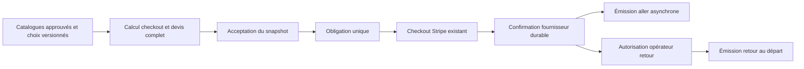

# SELBY — Lot C / C1-A — Architecture logistique Colissimo

Date : 6 novembre 2026. **Proposition à valider avant C1-B. Analyse et conception uniquement.**

Décisions acquises : les deux transports et leurs couvertures sont intégrés au devis accepté et au paiement unique ; bordereau aller après paiement effectivement confirmé ; retour Colissimo Domicile avec signature et couverture minimale obligatoire, créé seulement lorsque la commande est prête à expédier. Tarification au coût, sans marge, France métropolitaine initialement.

Les noms de tables, champs, états et interfaces ci-dessous sont des propositions, pas des éléments déjà implémentés. Aucune valeur tarifaire, limite de poids, couverture, franchise ou règle fiscale n'est fixée par ce rapport.

## 1. Cartographie de l'existant

### 1.1 Sources et limites de l'audit

Audit statique des modules applicatifs, migrations et tests cités ci-dessous. Aucune interrogation de base, publication de catalogue, migration, requête Stripe ou appel d'API Colissimo. Seule la documentation publique a été consultée sur le Web.

La grille professionnelle Colissimo 2026 annoncée comme fournie par le client n'a pas été retrouvée parmi les documents accessibles examinés. Les seuls PDF locaux identifiés sont des échantillons d'étiquettes internes. Les répertoires temporaires inaccessibles ne constituent pas une source vérifiée. Il faut rattacher la copie contractuelle exacte et ses annexes avant import ; aucun barème public ne lui est substitué.

Les pages officielles [Outils et solutions Colissimo](https://www.colissimo.entreprise.laposte.fr/outils-et-solutions) et [documentation technique d'affranchissement](https://www.applications.colissimo.entreprise.laposte.fr/doc-colissimo/redoc-sls/fr) identifient les fonctions d'étiquetage et de suivi à étudier. Le contenu intégral de la référence technique n'a pas été restitué par l'outil de consultation ; aucune garantie d'idempotence, de récupération d'étiquette ou de facturation n'est donc considérée comme vérifiée ici. Ces sources ne valident ni les tarifs du compte SELBY ni l'assurabilité des cartes.

### 1.2 Chaîne métier et points d'intégration

| Domaine | Existant observé | Intégration C1 proposée |
|---|---|---|
| Soumission | `app/submission_models.py` : `Submission`, entrées et quantités ; version de saisie et `pricing_revision`. `submissions.py` distingue brouillon et soumission confirmée. | Conserver ces identités ; rattacher les deux trajets et leur inventaire à la soumission. Une confirmation de soumission n'autorise aucun achat. |
| Grading et TVA | `pricing.py`, `pricing_schemas.py` : calcul en unités mineures, `Decimal`, arrondi HALF_UP ; fiscalité par service, remises et seuils du grading. | Ajouter les composantes logistiques à l'agrégat checkout, sans faire entrer le transport dans les remises grading ni changer leur calcul. |
| Livraison actuelle | `checkout_models.py` : adresses client versionnées ; `SubmissionDelivery` contient une adresse de retour, une valeur déclarée, un service et un colis JSON. | Ajouter des choix structurés pour les deux sens ; ne pas réinterpréter la valeur ou le colis historiques comme un engagement aller-retour. |
| Catalogue transport | `ShippingConfiguration.document` immuable par trigger UPDATE, pointeur `ShippingState`, publication opérateur `shipping_catalog.py`. Schéma `ShippingService` avec prix fixe, plafonds, couverture vérifiée et fiscalité. | Nouveau format capable de décrire trajets, tranches, éligibilité précise et preuves contractuelles ; préserver le lecteur historique. |
| Calcul checkout | `checkout.py:summary`, `shipping_amounts`, `context` : grading + un retour ; gardes adresse, pays, couverture, quantité et dimensions ; total indéterminé si incomplet. | Deux trajets dans le même calcul de readiness et de total. Invalidation sur toute entrée ou version logistique pertinente. |
| Devis | `SubmissionQuote.snapshot` JSON, `pricing_api.py:create_quote`, `quote_status` ; le contexte inclut versions adresse/livraison/transport. | Nouveau snapshot versionné avec toutes les lignes, entrées et preuves du calcul logistique. |
| Acceptation | `QuoteAcceptance`, contrôle de fraîcheur sous verrou, consentement explicite et `obligation_for` dans la même transaction. | Garder l'acceptation unique et la création de la même obligation complète. Aucune obligation séparée de transport. |
| Stripe | `stripe_checkout.py:accepted_obligation`, `start_checkout` : montant exact du snapshot et de l'obligation, une tentative active, clé durable ; Checkout expose actuellement une ligne agrégée. | Consommer le nouveau total figé sans changer les règles financières ou créer une Session logistique. |
| Succès fournisseur | `handle_event` : Session payée, PI réussi, montant exact reçu, Charge payée/capturée, contrôles de rattachement et restrictions. `VerifiedPayment` et événement commercial persistants. | Le service logistique lit uniquement la confirmation durable, après commit. Aucun achat depuis une page de retour Stripe. |
| Échéance | `commercial.py:record_provider_confirmation`, `DispatchExpectation` : succès fournisseur + 30 jours UTC ; `recorded_at` distinct. | Inchangé. Ni création, téléchargement, panne, revue ou utilisation d'étiquette ne relance cette échéance. |
| Déclaration et réception | `ShipmentDeclaration` est déclarative. `intake_models.Parcel` et `intake.py:register_parcel` enregistrent une réception opérateur et son audit, indépendamment du paiement. | Ajouter le lien optionnel à un envoi transporteur ; ne pas créer une réception depuis l'achat d'un bordereau ou une simple déclaration client. |
| Préparation retour | `checkout_api.py:return-parcel` et `return-parcel-panel.tsx` : poids/dimensions préparatoires, modifiables avant acceptation seulement, avec audit. | Conserver cet historique ; nouvelle préparation opérationnelle après grading, distincte des paramètres tarifaires acceptés. |
| Inspection et garde | `inspection_models.py` : états `in_progress` / `paused`, événements de garde ; contrôles d'éligibilité commerciale séparés. | Aucune preuve actuelle suffisante de « commande prête à expédier ». Concevoir une autorisation de sortie dédiée et validée. |
| Frontend | `order-workspace.tsx`, `checkout-panel.tsx`, `pricing-panel.tsx`, `paid-order-panel.tsx` ; interface opérateur intake et inspection. | Détailler aller/retour/couvertures, afficher téléchargement et suivi séparés par sens, garder les écrans historiques. |

Les migrations `0004`, `0005`, `0013` et suivantes installent des protections d'immuabilité : UPDATE des devis/catalogues/acceptations, UPDATE/DELETE de plusieurs journaux et preuves commerciaux. Ne pas les désactiver, ni supposer que toutes les tables historiques disposent déjà de protections DELETE équivalentes.

### 1.3 Écarts structurants

- Le service actuel a un prix fixe et des maxima, pas une grille de tranches tarifaires. Ses maxima de validation génériques ne sont pas des limites contractuelles Colissimo.
- `tracked` ne prouve pas une livraison avec signature. Un booléen global `trading_cards_coverage_verified` ne suffit pas pour toutes les cartes, catégories, valeurs ou les deux sens.
- `country=FR` ne suffit pas à caractériser le périmètre métropolitain éligible. Il faut une classification d'adresses et de zones contractuellement validée.
- L'adresse de réception SELBY actuelle est un texte de configuration, insuffisant comme adresse structurée d'affranchissement. L'adresse d'expédition du client peut différer de son adresse de retour.
- Le frontend indique encore que le client organise son aller et qu'aucune étiquette prépayée n'est générée (`lib/checkout.ts`). Ce texte devra changer pour les nouveaux devis, en conservant le contexte des anciens accords.
- Aucun modèle d'achat Colissimo, stockage d'étiquette transporteur ou journal de suivi transporteur n'a été identifié. Les étiquettes internes des cartes et leurs PDF ne sont pas des bordereaux Colissimo.
- Les devis complémentaires existants peuvent facturer un ajustement de retour via `additional_card_charge_minor`. **Ce chemin n'est pas une solution au paiement du retour normal C1** et ne doit pas être appelé automatiquement.

## 2. Modèle de données proposé

### 2.1 Séparation des engagements et de l'exécution

Conserver `SubmissionQuote`, `QuoteAcceptance`, `PaymentObligation`, `VerifiedPayment`, `StripeAttempt` et les journaux financiers comme référence financière unique. Les coûts facturés par Colissimo sont des dépenses fournisseur, pas de nouvelles dettes payables par le client.

| Structure proposée | Contenu et invariants |
|---|---|
| `LogisticsCatalog` | Document immuable, version UUID, version de format, empreinte, sources contractuelles et dates d'effet. Table dédiée recommandée pour éviter de déplacer le pointeur historique `ShippingState` vers un document incompatible. |
| `LogisticsCatalogPublication` | Journal de validation/activation/retrait, acteur, motif, périmètre et environnement ; sélection non ambiguë du catalogue pour les nouveaux devis. Retrait interdit pour les nouveaux achats si contrat révoqué, sans effacer les engagements historiques. |
| `SubmissionLogisticsSelection` | Brouillon versionné par soumission : adresses source/destination, options aller/retour, valeurs/inventaire, poids/dimensions déclarés, références de profils de colisage et consentements requis. Modifiable avant acceptation seulement. |
| Snapshot logistique du devis | Copie exhaustive des choix et lignes calculées, version du calculateur, catalogues et références contractuelles. C'est l'engagement immuable ; une FK vers un tarif courant ne le remplace pas. |
| `LogisticsShipment` | Envoi logique : soumission, devis accepté, sens, index de colis, inventaire, adresses et service engagés, préparation opérationnelle versionnée. Unicité du créneau logique par commande/sens/colis, indépendante de la clé d'une requête HTTP. |
| `ShipmentReleaseDecision` | Autorisation opérateur de départ retour : inventaire physique exact, contrôles de fin de traitement et de garde, colisage mesuré, signature/couverture, acteur, date, raison, versions concernées. Aucun simple statut d'inspection ne vaut autorisation. |
| `LabelOperation` | Réservation durable d'une émission : envoi logique, clé d'idempotence serveur, hash de requête, contrat/environnement, préconditions et identité de paiement, état technique, résultat/référence transporteur et ambiguïtés. Un seul achat initial actif par envoi. |
| `LabelArtifact` | Objet privé : clé de stockage, format, hash, taille, date et opération d'origine ; pas de données binaires dans le snapshot financier. Réimprimer/télécharger réutilise cet objet. |
| `LogisticsEvent` / `TrackingEvent` | Journaux append-only : origine, code brut, état normalisé, dates fournisseur/réception, identifiant ou empreinte de déduplication, références de preuve ; audit des décisions opérateur et des téléchargements. |
| `CarrierCostEvidence` | Coût contractuel attendu, coût fournisseur constaté et référence de facture, ventilation et écart. Aucune mise à jour du montant client et aucune commande de paiement. |

Les noms `customer_to_selby` et `selby_to_customer` décrivent les sens SELBY. Leur correspondance avec un produit commercial « Retour » de Colissimo doit être validée : l'aller SELBY peut relever d'un produit de retour transporteur ; on ne déduit aucun code API du mot « retour ».

Proposition initiale : un colis par sens, sous réserve de validation. La clé inclut néanmoins un index pour une évolution explicite ; dépassement de capacité = indisponibilité/revue, jamais achat automatique d'un deuxième colis.

Les associations d'inventaire doivent distinguer les exemplaires avant réception (`entry_id` + numéro d'exemplaire) puis les cartes physiques réconciliées. Aucun changement d'identité de carte ou de garde n'est induit par un suivi transporteur.

### 2.2 États distincts

Séparer trois axes plutôt qu'un statut global ambigu :

| Axe | États indicatifs proposés |
|---|---|
| Émission technique | `not_eligible`, `ready_to_request`, `reserved`, `requesting`, `label_available`, `outcome_unknown`, `rejected` |
| Acheminement | `not_observed`, `carrier_accepted`, `in_transit`, `delivered`, `delivery_exception`, `returning_to_sender` |
| Revue opérationnelle | indicateur avec motifs, décision et audit ; ne pas réutiliser le hold financier `restricted` |

`label_available` ne signifie ni débit définitif Colissimo, ni dépôt, ni livraison. L'instant de facturation transporteur est à confirmer. Un téléchargement ne crée pas de `ShipmentDeclaration`, de dépôt ou de réception. La livraison transporteur à SELBY est une information distincte de la réception physique et de la réconciliation d'intake.

## 3. Structure du catalogue tarifaire

### 3.1 Publication et traçabilité

Catalogue spécifique au contrat SELBY : format versionné, EUR et montants entiers, identifiant du contrat non secret, grille 2026 source avec empreinte et références de lignes/pages, dates d'effet et règle de date de tarification, service exact, sens SELBY, zones, tranches, options, taxes et exclusions. Les credentials sont stockés séparément.

Pour chaque ligne : prix contractuel et sa base HT/TTC à qualifier, composantes incluses, suppléments éventuels explicitement documentés, validateur, preuve et date de validation. Un tarif absent n'est jamais un tarif nul. Le catalogue reste non activable tant qu'une donnée obligatoire ou son approbation manque.

La validation contractuelle, tarifaire, fiscale et de couverture doit être explicite et historisée. Séparer les documents préparatoires des publications activables ; la présence d'un JSON valide techniquement ne constitue pas une approbation de production.

Schéma illustratif volontairement incomplet, **non publiable et non importable comme tarif actif** :

```json
{
  "schema_version": "proposal",
  "carrier": "colissimo",
  "currency": "EUR",
  "contract_reference": null,
  "source_document_sha256": null,
  "effective_period": null,
  "geographical_rules": null,
  "product_mappings": [],
  "weight_bands": [],
  "packing_profiles": [],
  "coverage_rules": [],
  "tax_validation": null,
  "production_approved": false
}
```

### 3.2 Tranches et sélection

Chaque tranche réelle devra porter identifiant, unité, bornes et inclusion/exclusion des bornes telles que la grille les définit, produit, zone, période et montant. Refuser les chevauchements applicables, trous non signalés ou sélections multiples ; ne jamais choisir arbitrairement la tranche la moins chère ni étendre la dernière tranche au-delà de son maximum.

Poids facturable : poids du colis emballé, incluant protections et, au retour, boîtiers. Le mode de calcul (poids réel, règle d'arrondi ou autre contrainte) doit provenir du contrat ; aucune règle volumétrique ou de conversion n'est présumée. Dimensions et règles de gabarit doivent également être documentées.

Pour un retour payé avant grading, proposer un profil de colisage versionné et validé fondé sur l'inventaire et les emballages effectivement prévus. Le nombre de cartes seul ne détermine pas un poids sans ces données. Sans profil suffisamment fiable ou mesure disponible, le total reste indéterminé et le Checkout est bloqué. Au départ, les mesures réelles sont comparées à l'engagement ; elles ne réécrivent pas le devis.

### 3.3 Couvertures

Décrire séparément inclusion de base, couverture minimale retour obligatoire, choix supérieur et éventuelle assurance complémentaire aller. Pour chaque option : éligibilité des biens/états/catégories, valeurs admises, plafond par objet et/ou colis si prévu, justificatifs, exclusions, franchise, obligations d'emballage, territorialité, cumul/substitution et version contractuelle. Aucun montant ni cumul de garanties n'est supposé.

La valeur déclarée n'est ni le prix du grading ni une promesse d'indemnisation. Conserver, si nécessaire contractuellement, des valeurs par exemplaire et par sens ; la valeur d'une carte après grading peut différer. Si la couverture de cartes de collection, d'un type de carte ou de sa valeur n'est pas confirmée, l'option n'est pas présentée comme assurante. Pour le retour obligatoire, l'absence de couverture admissible bloque l'offre ; aucune dégradation silencieuse vers un service non couvert.

## 4. Calcul détaillé des frais

### 4.1 Algorithme déterministe proposé

1. Lire sous contrôle de version les entrées de grading et les choix logistiques ; sélectionner un seul catalogue approuvé pour le périmètre et la date retenus.
2. Valider séparément les deux adresses, la zone métropolitaine contractuelle, le produit aller et le retour Domicile avec signature obligatoire.
3. Établir les paramètres de colisage de chaque sens et leur provenance : mesure client, mesure opérateur ou profil approuvé. Conserver l'entrée originale et la transformation documentée.
4. Sélectionner exactement une tranche applicable par colis/sens, puis les options de couverture admissibles. Appliquer les seules composantes/surcharges contractuelles identifiées, sans double comptage des services inclus.
5. Produire des lignes monétaires identifiées et une trace de sélection : entrées, règles, résultats intermédiaires, bornes, références et motifs d'éligibilité/refus.
6. Appliquer le traitement fiscal validé à chaque composante en réutilisant les conventions existantes d'unités mineures et d'arrondi ; sommer les lignes arrondies.
7. Si une donnée obligatoire est absente, ambiguë, hors périmètre ou non validée : `readiness.ready=false`, total payable indéterminé, aucune acceptation payable.

### 4.2 Ventilation et égalités

Lignes proposées : `grading`, `inbound_transport`, `inbound_extra_coverage`, `return_transport`, `return_required_coverage`, `return_extra_coverage`, et seulement les suppléments fournisseur documentés. Chaque montant est distingué du grading dans l'historique et le justificatif.

Une couverture/signature déjà incluse au tarif de transport est explicitement indiquée comme **incluse**, sans inventer une allocation monétaire ni la facturer deux fois. Les identifiants de lignes chargeables sont uniques ; les annotations de services inclus ne participent pas une seconde fois à la somme. Une option aller non choisie peut contribuer zéro, mais seulement si son absence est explicitement admissible ; une prime inconnue reste inconnue.

Soit `G` le total grading existant, `A` le transport aller, `IA` l'assurance aller sélectionnée, `R` le transport retour, `CR` sa couverture obligatoire et `SR` son supplément, comptés chacun une seule fois :

```text
Total accepté = G + A + IA + R + CR + SR + suppléments contractuels applicables
Pour chaque ligne chargeable : total_minor = net_minor + tax_minor
Total accepté = somme(total_minor des lignes chargeables)
net_total_minor = somme(net_minor)
tax_total_minor = somme(tax_minor)
Total accepté = net_total_minor + tax_total_minor
```

Les formules fiscales existantes sont à préserver : extraction de taxe incluse par `rounded_ratio(montant, taux, 10000+taux)` ; ajout de taxe exclusive par `rounded_ratio(montant, taux)` ; exonération uniquement si validée. Le présent rapport ne choisit aucun de ces régimes, taux ou assiettes pour Colissimo/assurance. Une taxe inconnue ne devient pas une exonération.

**Au coût sans marge** nécessite une décision comptable : coût fournisseur HT, TTC, taxes récupérables/non récupérables et éventuels frais contractuels. On ne copie pas un TTC fournisseur dans une assiette HT client par défaut. La base de coût et sa transformation fiscale doivent être approuvées et tracées, sans frais de gestion inventés. Les remises grading existantes restent limitées à leur assiette actuelle.

### 4.3 Prix figé et coût futur : point bloquant avant activation

Le retour sera acheté après traitement, potentiellement après changement de tarif, alors que le client paie tout avant. Il faut valider la date d'application contractuelle, la validité de l'engagement tarifaire, le profil de colisage et le traitement des écarts fournisseur.

Recommandation : n'activer que des offres dont le coût et les conditions peuvent être déterminés et honorés pour les deux trajets au moment de l'acceptation. Si le coût réel ou le poids final diffère ensuite, conserver le montant payé et mettre l'exécution en revue. **Ni supplément Stripe, ni second devis payable de retour normal, ni prélèvement, remboursement ou prise en charge de l'écart par SELBY ne sont décidés automatiquement.** L'arbitrage commercial de ces écarts est requis avant activation ; une simple provision approximative serait incompatible avec l'interdiction de prix provisoires.

## 5. Intégration au devis et à Stripe

### 5.1 Un seul engagement financier

Étendre le calcul de `checkout.summary`, pas créer un calcul de prix financier indépendant dans l'adaptateur transporteur. Le nouveau catalogue alimente ce calcul ; il ne crée aucune obligation client supplémentaire.

Le nouveau snapshot doit contenir une version explicite de format, les deux trajets, les adresses copiées, l'inventaire/valorisation et leur provenance, les profils de colisage, catalogue et règles utilisés, la ventilation des montants/taxes, les termes et leur version, ainsi que la trace de calcul. L'empreinte canonique est utile au rapprochement mais ne remplace pas les données du snapshot ni ses protections d'immuabilité.

Étendre `checkout.context` et `quote_status` aux versions de sélection, adresses des deux sens, catalogue, profils de colisage et règles d'éligibilité. Une modification avant acceptation invalide le devis, qui doit être recalculé et accepté ; une publication tarifaire concurrente doit avoir un ordre sérialisé avec l'acceptation. Un devis accepté continue à être lu depuis son snapshot, jamais recalculé aux tarifs courants.



Invariants à tester sans tolérance monétaire :

```text
snapshot.checkout.final_payable_minor
  = snapshot.order_total_minor
  = PaymentObligation.amount_minor
  = Session.amount_total
  = PaymentIntent.amount
  = montant effectivement reçu exigé pour confirmation
```

La racine historique `snapshot.total_minor` reste le grading ; ne pas la transformer en total logistique ni l'utiliser pour Checkout. Les contrôles Stripe de compte, devise, identité, montant et preuve de succès restent inchangés. B-P2 et B-DISPUTE restent inchangés ; aucune étiquette en l'absence de paiement vérifié ou en présence d'une restriction financière applicable.

### 5.2 Historique, justificatifs et périmètre

Recommandation C1-B minimale : conserver la ligne Stripe agrégée existante, dont le montant vient de l'obligation ; détailler grading, transport et couvertures dans le devis et les restitutions/justificatifs SELBY issus du snapshot. Une éventuelle ventilation Stripe sera une évolution distincte, à somme strictement identique, sans recalcul automatique de taxe ou d'option transport dans Stripe.

Le schéma des lignes doit porter libellé FR/EN, nature, sens, montants HT/taxe/TTC et référence du devis. Un futur document comptable doit consommer cette ventilation figée et le paiement unique ; ce rapport ne prétend pas qu'un générateur de facture fiscale complet existe déjà, ni qu'un reçu Stripe agrégé le remplace.

Ne pas activer C1 rétroactivement sur une soumission historique, ni affirmer que son ancien retour finance aussi l'aller. Les snapshots grading seuls et anciens snapshots avec retour restent lisibles tels quels. Les cartes supplémentaires et ajustements commerciaux existants restent un périmètre séparé : ils ne sont pas utilisés pour compléter artificiellement le transport normal prépayé.

## 6. Parcours client et opérateur

### 6.1 Client

Avant devis : renseigner les adresses des deux sens, les informations de colisage aller demandées, l'inventaire et les valeurs nécessaires. Afficher seulement les produits et couvertures admissibles, les exclusions et l'obligation de signature/couverture retour. Le plan de colisage retour doit être déterminé avant acceptation, même si le colis réel n'existe pas encore.

Avant paiement : présenter séparément grading, aller, assurance aller éventuelle, retour et couverture obligatoire/supplémentaire, taxes et total. Garder le consentement explicite sur le devis exact ; tout élément indéterminé bloque l'acceptation payable.

Après paiement réellement vérifié : afficher « étiquette en préparation », puis proposer le téléchargement privé de la même étiquette aller. Informer des instructions d'emballage, éventuelle validité d'utilisation contractuelle et distinction entre téléchargement et dépôt. Le suivi est consultable par sens ; la déclaration client reste identifiée comme déclaration, jamais comme preuve transporteur.

Au retour : afficher préparation, remise au transporteur et suivi dès qu'ils sont observés. Pas de bouton « payer le retour » pour l'expédition normale ; l'achat fournisseur du retour ne débite pas le client une seconde fois.

### 6.2 Opérateur

Une vue logistique distincte expose devis accepté, ventilation, paiement vérifié/restrictions en lecture seule, deux trajets, état d'émission, suivi, incidents et audit. Aucun bouton opérateur ne permet de marquer payé ou de contourner une couverture contractuellement inconnue.

Réception : utiliser les contrôles d'intake existants pour constater et réconcilier les cartes effectivement reçues. Le suivi facilite le rapprochement mais ne remplace ni l'identité physique, ni l'audit, ni la garde.

Préparation retour : inventorier les cartes réelles, vérifier les autorisations commerciales et de sortie, mesurer le colis final et contrôler l'adresse, le produit avec signature et la couverture prévue. La règle complète « prêt à expédier » doit être validée : les modèles actuels d'inspection ne définissent pas une fin de grading ou d'encapsulation autorisant le départ. Créer seulement ensuite l'opération d'étiquette retour.

Tout changement d'adresse ou de contenu après acceptation exige une demande tracée et un examen d'impact. La copie commerciale du devis n'est jamais écrasée. Une correction opérationnelle compatible, si autorisée, porte une nouvelle décision et un nouveau snapshot opérationnel ; incompatibilité de zone/coût/couverture = revue, pas nouvelle collecte automatique.

### 6.3 Déclenchement et idempotence des bordereaux

1. Un worker observe les `provider_payment_verified` **commités**, avec réconciliation des `VerifiedPayment` pour récupérer les déclenchements manqués. Il n'est pas nécessaire de changer les règles de confirmation Stripe ; aucun appel transporteur n'est placé dans leur transaction ou leur réponse HTTP.
2. Pour chaque envoi, contrôler paiement, devis, environnement, restrictions, couverture et préconditions ; pour le retour, exiger en plus une décision de sortie encore valide.
3. Sous verrou de commande/envoi, réserver durablement `LabelOperation` et sa clé serveur déterministe. L'unicité du créneau d'émission empêche deux clients, workers ou clés HTTP de créer deux achats.
4. Après commit, préparer une requête figée, revérifier les préconditions au plus près de l'envoi et appeler le futur adaptateur. Ne pas maintenir un verrou DB pendant l'appel réseau. Conserver le hash de la requête et une référence de corrélation non secrète.
5. Persister le résultat et l'artefact, puis publier la disponibilité. Un crash après succès transporteur avant sauvegarde est un résultat ambigu à réconcilier, pas une autorisation de réémettre.
6. Tout téléchargement/réimpression réutilise l'artefact et n'appelle pas la création Colissimo. Une clé réutilisée avec un contenu différent renvoie un conflit.

Une outbox logistique et des leases de workers sont recommandées, mais **un lease expiré ne prouve pas l'absence d'achat fournisseur**. En l'absence de garantie transporteur vérifiée d'idempotence/récupération, un timeout après émission conduit à `outcome_unknown` et revue. Pas de retry aveugle ni promesse d'exécution exactement une fois chez le fournisseur.

Une restriction financière peut arriver après le dernier contrôle et pendant l'appel externe : aucune transaction locale ne rend cette course atomique avec Colissimo. L'événement est conservé, l'opération passe en revue et aucune nouvelle émission n'est tentée automatiquement. Aucune réponse au litige, annulation financière ou remboursement n'est déclenché par cette architecture.

## 7. Gestion des erreurs et future intégration API

### 7.1 Erreurs et actions permises

| Situation | Traitement recommandé |
|---|---|
| Tarif, fiscalité, adresse, zone, poids ou couverture inconnus avant acceptation | Conserver la saisie, rendre le motif explicite, bloquer total payable et Checkout. |
| Catalogue changé avant acceptation | Invalider le devis non accepté, proposer un nouveau calcul ; aucun écrasement du snapshot. |
| Paiement pending/action_required/B-P2 ou non vérifié | Attendre les mécanismes financiers existants ; aucun bordereau. |
| Produit indisponible, couverture révoquée, poids ou coût différent après paiement | Revue logistique avec preuves ; aucun second paiement ou changement de service/signature/couverture automatique. |
| Rejet fournisseur certain sans création | Conserver code/message expurgés ; correction opérateur sous version et mêmes contrôles. Réessai uniquement si l'absence d'effet est établie. |
| Timeout, 5xx ou connexion coupée après envoi possible | Résultat ambigu, réservation conservée ; récupérer/rapprocher selon capacités contractuellement vérifiées. Aucun nouvel achat. |
| Succès mais stockage PDF indisponible | Conserver la référence et le résultat fournisseur ; récupérer le document s'il existe une méthode supportée. Ne pas relancer une création pour retrouver un PDF. |
| Étiquette perdue côté client / téléchargement interrompu | Renvoyer le même artefact avec contrôle d'accès ; pas d'achat. |
| Étiquette périmée ou incorrecte | Revue opérateur ; aucun remplacement/achat supplémentaire automatique. Validité et procédure à confirmer. |
| Suivi absent ou service de suivi indisponible | Afficher dernière observation et date ; absence d'observation ne signifie pas absence de dépôt. Backoff borné uniquement pour lectures sans effet de bord. |
| Événements dupliqués, désordonnés ou correctifs | Conserver preuves brutes et dates ; dédupliquer les effets et appliquer un mapping versionné, sans écraser l'histoire ni régresser naïvement sur l'ordre d'arrivée. |
| Facture Colissimo différente du coût prévu | Tracer et expliquer l'écart fournisseur ; aucune écriture dans l'obligation ou le paiement client. |

### 7.2 Informations à obtenir pour l'adaptateur Colissimo

- Contrat et compte facturés, habilitations, produits exacts par sens, modalités d'affranchissement aller prépayé et retour signé, facturation et annulation éventuelle. Ne pas assimiler génération technique et achat définitivement facturé.
- Version de spécification, environnements et accès Sandbox, authentification et rotation des secrets, formats requête/réponse/étiquette, unités et précision des valeurs, codes erreurs et limites de débit.
- Champs réellement obligatoires : adresses structurées, expéditeur/destinataire et contacts, poids/gabarit, code produit, options de couverture et signature, références client ; mapping exact de la valeur déclarée et de son unité.
- Support réel d'une clé idempotente, durée de rétention, unicité de la référence client, méthodes de recherche/récupération et preuve qu'un échec n'a créé aucune étiquette. Sans réponse vérifiée, garder la voie ambiguë manuelle.
- Modalités de suivi : lecture ou notifications, authentification des événements, identifiants, codes, corrections, dates, délai de disponibilité et preuve de remise/signature accessible. Aucun webhook ou endpoint précis n'est présumé.
- Restrictions du Sandbox, notamment identifiants potentiellement synthétiques/réutilisés. La référence locale d'opération reste la clé ; ne pas dédupliquer des essais distincts sur le seul numéro de suivi.

Stockage privé des documents, chiffrement/gestion des secrets, autorisation client propriétaire ou opérateur habilité, liens temporaires si utilisés, limites MIME/taille et contrôle d'intégrité. Ne pas placer de lien public permanent ou de donnée personnelle d'étiquette dans les métadonnées Stripe. Journaux techniques expurgés ; conservation des adresses, preuves et documents selon une politique à valider, sans altérer les historiques commerciaux existants.

## 8. Plan de migrations éventuelles

**Aucune migration créée ou exécutée en C1-A.** Révisions futures à attribuer selon l'état réel du dépôt au lancement, sans présumer d'un prochain numéro.

1. Après validation, ajout de catalogues/publications et choix logistiques versionnés. Garder `ShippingConfiguration`, `ShippingState` et les routes historiques ; prévoir un dispatch explicite par version de snapshot/cohorte de nouvelle commande, pas une bascule globale ambiguë.
2. Nouveau format de snapshot, lecteur compatible avec les formats historiques et adaptateur de calcul vers l'agrégat existant. Aucun backfill de prix, d'assurance, de statut payé ou de financement aller dans un ancien devis. Un nouveau catalogue ne modifie que les nouveaux calculs avant acceptation.
3. Ajout des envois, réservations d'émission, autorisations de sortie, artefacts, outbox et journaux. FK vers les identités existantes, contraintes d'unicité des opérations, contrôle des transitions et immuabilité des preuves. Pas de cascade supprimant paiements, devis acceptés ou journaux existants.
4. Indexes et garde de concurrence, droits d'accès et stockage documentaire ; nouvelles fonctionnalités désactivées par défaut et adaptateur transporteur sans capacité d'émission tant que non validé.
5. Reprise des commandes existantes uniquement via une procédure opérateur approuvée, sans achat automatique déclenché par un ancien `VerifiedPayment`. Le worker doit exiger un snapshot C1 admissible et un créneau d'émission explicite.
6. Déploiement progressif : validation documentaire du catalogue, tests déterministes, validation Sandbox autorisée séparément, puis activation production explicitement approuvée. Le garde Stripe TEST actuel reste inchangé ; C1 ne constitue pas une autorisation Stripe LIVE.

Retour arrière fonctionnel : désactiver nouvelles publications/émissions et arrêter les workers, tout en maintenant lectures et téléchargements existants. Ne pas supprimer les preuves ou revenir par migration destructive après un effet externe. Les downgrades de tables avec historique doivent être refusés ou remplacés par une procédure d'archive approuvée.

## 9. Plan de tests

| Ensemble | Cas indispensables avant activation |
|---|---|
| Catalogue | Validation de la vraie grille et de ses sources ; approbation absente/non valide ; tarifs manquants ; chevauchements de périodes/zones/tranches ; fiscalité/couverture non confirmées ; aucune publication d'un brouillon. |
| Géographie | Adresses métropolitaines réellement admissibles, cas limites définis par le contrat, FR hors périmètre, destination inconnue et adresses aller/retour différentes. Aucun raccourci pays = zone. |
| Poids/gabarit | Toutes les bornes réelles de chaque tranche, juste en dessous/au-dessus selon unité contractuelle ; profil incomplet, mesures invalides, boîtiers/emballage retour, dépassement ou pluralité de colis non autorisée. |
| Couvertures | Cartes/catégories/valeurs non admissibles, exclusions, preuve absente, minimum retour obligatoire, supplément choisi/non choisi, garantie incluse sans double comptage et différences aller/retour. |
| Montants | Même entrée/version = mêmes lignes et total ; pas de flottants monétaires ; arrondis fiscaux validés, taxes hétérogènes si applicables ; transport au coût, hors remises grading ; égalité stricte snapshot/obligation/Stripe/succès. |
| Immuabilité | Publication concurrente avec génération/acceptation ; modification adresse/choix/inventaire avant accord ; impossibilité de modifier un snapshot accepté ; anciens formats et devis complémentaires conservés. |
| Déclenchement | Pas d'émission avant confirmation durable, ni sur retour navigateur ; webhook retardé/dupliqué ; crash et réconciliation après commit ; zéro émission rétroactive d'une commande historique. |
| Retour | Aucune création avant autorisation de départ ; autorisation obsolète après modification du colis/inventaire ; signature ou couverture insuffisante ; dépassement du coût figé en revue sans deuxième paiement. |
| Idempotence | Requêtes concurrentes, workers concurrents, clés différentes pour le même envoi, crash aux frontières réseau/DB/stockage, résultat ambigu et lease expiré ; aucune création supplémentaire lors d'un téléchargement/réimpression. |
| Suivi et réception | Doublons, ordre inversé, événements correctifs, données étrangères à l'envoi ; dépôt distinct d'étiquette, livraison transporteur distincte de réception/réconciliation SELBY. |
| Sécurité | Propriété de la commande, rôles opérateur, CSRF des mutations, accès PDF d'un autre client, expiration des liens éventuels, secrets/PII absents des logs et de Stripe, absence d'émission via GET. |
| Non-régression | Suites `test_checkout`, `test_pricing`, `test_pricing_concurrency`, `test_return_preparation`, `test_paid_order_foundation`, `test_stripe_checkout`, tests isolés Lot B, intake/inspection et frontend ; B-P2/B-DISPUTE inchangés ; échéance succès fournisseur + 30 jours unique malgré achats/reprises/incidents. |

Distinguer les preuves : tests de calcul et faux transporteur = validation de SELBY ; tests Sandbox ultérieurement autorisés = comportement de ce Sandbox ; contrat et validation de compte = conditions de production. Aucun de ces niveaux ne démontre à lui seul l'assurabilité de toutes les cartes.

Pour C1-A, aucun test applicatif n'est exécuté : aucun code n'est modifié. La vérification porte sur la présence des dix rubriques, les références locales et l'absence de paramètres tarifaires inventés. Les bancs qui exécutent des migrations ou des effets externes ne doivent pas être lancés pour une simple revue documentaire.

## 10. Décisions nécessaires avant implémentation

| Décision / document attendu | Conséquence tant que manquant |
|---|---|
| Validation de l'architecture et du périmètre C1-B | Aucun développement métier ou migration. |
| Copie de la grille professionnelle 2026, avenants, remises/surcharges contractuelles, dates et contrat SELBY | Aucun prix actif ou barème substitutif. |
| Produits contractuels correspondant aux deux sens, signature retour et limites géographiques détaillées | Aucune correspondance de code produit ni éligibilité implicite. |
| Couverture des cartes selon catégories/états/valeurs, minimum retour, options, plafonds, franchises et justificatifs | Pas de promesse d'assurance ; offre complète bloquée si couverture obligatoire indéterminée. |
| Règles de colisage avant devis, poids/dimensions/emballages, mesure ou profil admissible et nombre de colis initial | Pas de tranche sélectionnée à partir d'une approximation non validée. |
| Base comptable du « coût », traitement fiscal de chaque composante et mentions justificatives | Pas de calcul fiscal actif ou assimilation automatique HT/TTC. |
| Date du tarif applicable, validité des étiquettes et politique des écarts de coût/poids entre paiement et retour | Pas de stratégie de supplément, d'absorption ou de remboursement implicite. Blocage/revue des cas indéterminés. |
| Checklist et habilitations de « prêt à expédier », fin de grading/encapsulation et autorisation de sortie de garde | Aucun achat retour déduit des états d'inspection actuels. |
| Gestion des changements après paiement : adresse, contenu, valeur, perte/péremption d'étiquette, carte non admissible | Revue documentée sans réécriture du devis ou deuxième tentative payable. |
| Contrat API et documentation complète, garanties d'idempotence/récupération, suivi et limites Sandbox | Adaptateur non opérationnel ; aucun retry financier supposé sûr. |
| Identité et adresses structurées SELBY, contacts, politique de conservation et accès aux étiquettes/preuves | Pas d'affranchissement ni de document public. |
| Régime de transition des anciennes commandes et des cartes supplémentaires | Pas de rééquipement automatique ou financement supposé acquis. |

Les décisions métier déjà acquises ne sont pas remises en question : paiement initial unique de l'ensemble, retour normal prépayé, signature et couverture minimale retour obligatoires, frais supportés par le client, aucun bordereau avant les préconditions de son sens.

**Arrêt C1-A : seul ce rapport est ajouté. Aucun code métier, schéma, catalogue actif, B-P2 ou B-DISPUTE modifié ; aucun bordereau généré, API Colissimo appelée ou paiement Stripe effectué. C1-B attend la validation de l'architecture.**
